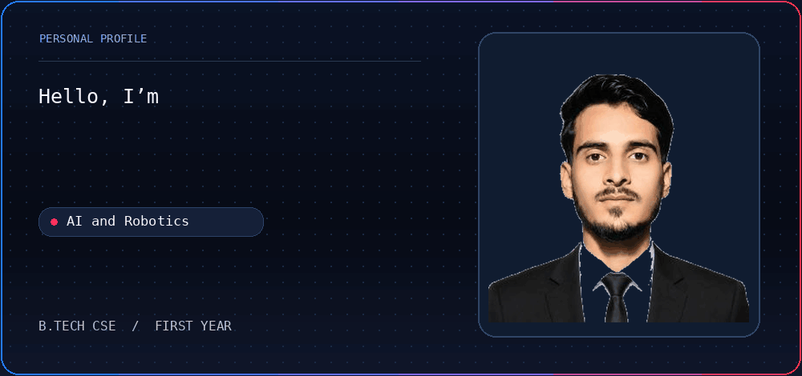
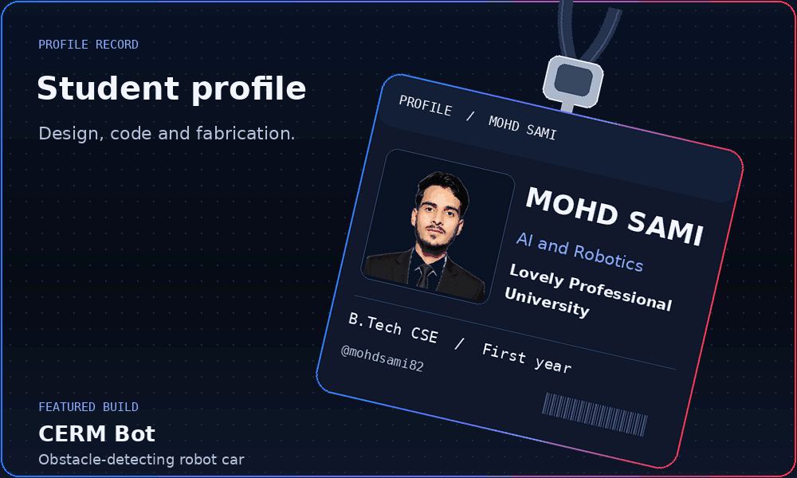

## About me

I'm a first-year B.Tech Computer Science and Engineering student specializing in Robotics and AI at LPU. What I enjoy most about hardware is taking a design off the screen and figuring out how to build it. I'm especially interested in mechanical design and fabrication.

## Featured build · CERM Bot

CERM Bot is a robot car that detects obstacles. Working on it was one of my favourite hands-on experiences. It made me want to spend more time designing parts and building hardware I can test myself.

## My toolkit

- **Python** for programming
- **AutoCAD** for drafting and design
- **Creo** for exploring 3D mechanical design

[Connect with me on LinkedIn](https://www.linkedin.com/in/mohd-sami-22887a44b/)
